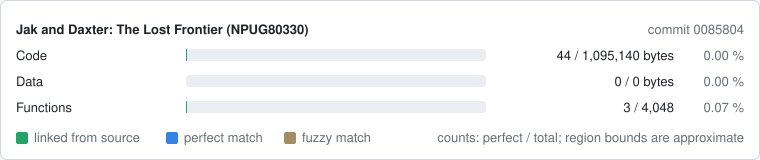

Jak and Daxter: The Lost Frontier (PSP)
=======================================

A work-in-progress matching decompilation of Jak and Daxter: The Lost Frontier for
the PlayStation Portable, built with [splat](https://github.com/ethteck/splat).

This repository does **not** contain any game assets or assembly whatsoever. An
existing copy of the game is required.

It builds the following modules:

Version   | Module | SHA1 hash of the input
--------- | ------ | ------------------------------------------
NPUG80330 | ISO (US, `DISC_VERSION 1.00`) | `70ec78b94b142fdff3072c207b13cb6cda22941e`
NPUG80330 | `USRDIR/BIN/LEVELSTARTUP_DISC.PRX` | `c0204feebb7ba0e643b12008880da7b074b627cf`

Progress
========

| Release | Disc ID | Progress |
|---|---|---|
| Jak and Daxter: The Lost Frontier (US) | `NPUG80330` | [](notes/PROGRESS.md) [](notes/PROGRESS.md) [](notes/PROGRESS.md) |

[](notes/PROGRESS.md)

- **Fuzzy**: objdiff fuzzy match score over all code.
- **Perfect**: code that matches byte for byte.
- **Linked**: code built from source (the `cpp` units of the splat config).

The badges and the card are drawn from the objdiff report by
`tools/progress_badges.py`. After `ninja report`, `python tools/progress_badges.py
--record` redraws `progress/NPUG80330/` and adds the current commit to
`progress/NPUG80330/history.csv`; commit the `progress/` folder with it.

Dependencies
============

- [Python](https://www.python.org/downloads/) 3.10+ in `%PATH%`, then
  `pip install -r tools/requirements.txt`.
- [ninja](https://github.com/ninja-build/ninja/releases) in `%PATH%`
  (`pip install ninja` works too).
- [7-Zip](https://www.7-zip.org/) to extract the ISO.
- On Windows use native tooling; WSL or msys2 are not required.

The MIPS binutils, the SN Systems compiler (from the decomp.me compiler archive),
wibo (on Linux and macOS) and objdiff-cli are downloaded by the first `ninja` run.

Building
========

1. Copy the ISO to `orig/NPUG80330/` (any file name ending in `.iso`).
2. Run:

   ```
   python tools/extract.py
   python tools/configure.py
   ninja
   ```

   A build ends with `build/NPUG80330/LEVELSTARTUP_DISC.PRX: OK`.
3. `ninja report` writes the objdiff report (`build/NPUG80330/report.json`);
   `objdiff.json` is there for the objdiff GUI.

Documentation
=============

- `SPEC.md`: target module, toolchain, build pipeline, acceptance criteria, naming.
- `notes/`: PRX format, compiler evidence, region map, matching techniques,
  references and provenance of reused code, progress log.
